<!--
  English version of niccoxx's GitHub profile README.
  The Italian version (README.md) is the one GitHub shows on the profile.
-->

<p align="right"><a href="./README.md">🇮🇹 Italiano</a> · 🇬🇧 English</p>

<h1 align="center">Hi, I'm Nicola 👋</h1>
<h3 align="center">DevOps Engineer · Automation Specialist</h3>
<p align="center"><i>Automation, cloud infrastructure and DevOps · Open source and Linux lover 🐧</i></p>

<p align="center">
  <a href="https://www.nickworlds.it"></a>
</p>

<p align="center">
  
  
  
  
  
  
  
</p>

---

```console
$ whoami
role           DevOps Engineer / Automation Specialist
os             Linux · FreeBSD · CentOS
shell          bash · python
orchestration  Kubernetes · Helm · AWS
iac            Terraform · Ansible · CloudFormation
uptime         18 years (since 04/2008)
```

### 🧑‍💻 About me

- 🏗️ I love building **resilient infrastructure** and automating repetitive workflows, freeing up the team's time and reducing human error
- 🔁 I work with **GitOps** and **Infrastructure as Code** approaches, turning complex requirements into clear, repeatable pipelines
- 📚 I keep up to date by reading tech blogs, experimenting with new tools and sharing knowledge in communities
- 🐧 Linux addict since forever: since 2010 I've been writing about distros, KDE and open source on **Nickworlds**
- 🏃 Away from the keyboard I go running outdoors to recharge

---

### 💼 Experience

```console
$ git log --oneline career/
```

| Period | Role | Focus |
|---|---|---|
| **10/2025 – present** | DevOps Engineer / Automation Specialist | CI/CD with Jenkins, GitLab CI and GitHub Actions · automation with AWX · GitOps |
| **01/2022 – 11/2025** | DevOps Engineer / Automation Specialist | Kafka clusters on Kubernetes and on-prem · AWX · Prometheus/Grafana · migration to AWS with CloudFormation · ElasticSearch |
| **11/2018 – 12/2021** | DevOps Engineer | Kubernetes environments · Jenkins pipelines · Prometheus/Zabbix · Kong API Gateway · Couchbase, Cassandra and Kafka clusters |
| **09/2014 – 11/2018** | System Engineer / DevOps Engineer Tech Lead | FreeBSD/CentOS servers · HP Vertica and Hortonworks Hadoop clusters · Java Spring Boot apps · Nagios/Zabbix · F5 Networks |
| **09/2009 – 09/2014** | Helpdesk – System Engineer | Second-level helpdesk · ticket management, application configuration · VPN, telephony, hardware migrations, corporate network |
| **04/2008 – 06/2009** | Helpdesk – System Engineer | Junior sysadmin · domain migrations, backups, multi-site client configuration |

---

### 🛠️ Skills

**☁️ Cloud & Orchestration**


**🧱 Infrastructure as Code & Automation**


**🔁 CI/CD & GitOps**


**📨 Streaming, Search & Data**


**📈 Monitoring & Networking**


**🐧 Systems & Languages**


---

### 🚀 Professional projects

```console
$ ls -l projects/
```

| Project | What I did | Stack |
|---|---|---|
| ☸️ **Kafka → Kubernetes** | Migrated Kafka clusters from on-prem to AWS EKS, with fully automated provisioning of the architecture | Kubernetes · EKS · Kafka · Ansible · CloudFormation |
| 🔎 **ElasticSearch → OpenSearch** | Migrated on-prem ElasticSearch to managed OpenSearch on AWS, with automation and monitoring pipelines | AWS · OpenSearch · Terraform · Prometheus |
| 📊 **Monitoring Dashboard Suite** | Grafana dashboards for environment KPIs and dedicated microservices for Kafka monitoring | Grafana · Prometheus · Kafka · Python · Docker |
| 🧩 **CloudFormation Stack Automation** | Templates to create complete application stacks on demand across multiple AWS accounts | CloudFormation · Terraform · Ansible · Jenkins |
| 🔁 **GitLab CI Pipelines** | CI/CD pipelines for automated build and delivery, alongside Jenkins and GitHub Actions | GitLab CI · Jenkins · GitHub Actions |
| ⚙️ **AWX Automation** | GitOps automation workflows for repeatable infrastructure tasks | AWX · Ansible · GitOps |
| 🐙 **ArgoCD Customization** | Customized Argo CD for GitOps continuous delivery on Kubernetes | Argo CD · Kubernetes |
| 🚢 **XL Release Orchestration** | Release orchestration and automation | XL Release · CI/CD |

### 🧪 Open source repositories

| Repository | Description |
|---|---|
| [kafka-cluster](https://github.com/niccoxx/kafka-cluster) | Local Kafka cluster with Docker Compose, Podman compatible |
| [redpanda-java-client](https://github.com/niccoxx/redpanda-java-client) | Java client for Redpanda |
| [cassandra-web](https://github.com/niccoxx/cassandra-web) | Web interface for Apache Cassandra |
| [markdown-generator](https://github.com/niccoxx/markdown-generator) | Automatically generates the CHANGELOG from git commits |
| [markdown-template](https://github.com/niccoxx/markdown-template) | Markdown template for documentation |
| [python_exp](https://github.com/niccoxx/python_exp) | Python experiments and exercises |

---

### 📊 GitHub stats

<p align="center">
  
  
</p>

---

```console
$ systemctl status nicola
● nicola.service - DevOps Engineer
     Active: active (running) since 04/2008
     Docs:   https://www.nickworlds.it
```
